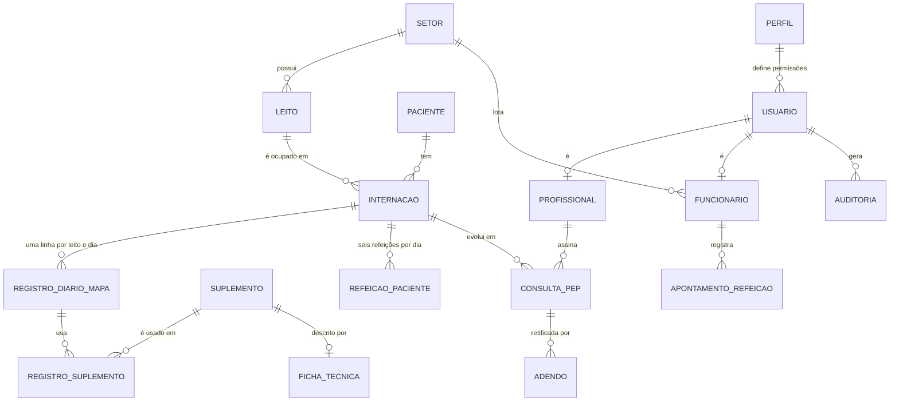

# ADR-0003 — Arquitetura multiusuário preliminar e modelo de domínio

- **Estado:** **Proposta.** Não há decisão final de tecnologia; esta ADR fixa princípios, requisitos e o modelo de domínio
  preliminar, e lista o que depende do hospital. Será substituída por uma ADR "Aceita" na Fase 3.
- **Data:** 10/11/2026 (America/Recife)
- **Fase do ROADMAP:** 0 — atividade 4 (arquitetura e contratos); insumo da Fase 3
- **Branch:** `feat/fase-0-fundacao-seguranca-banco`
- **Papéis:** `database-backend-engineer` (líder) e `qa-security-reviewer`

## Contexto

- O README (seções 7 e 8) pede uso simultâneo em computadores e celulares, apontamento de refeição de servidores por
  setor, PEP com autoria e trilha de auditoria, e proíbe compartilhar SQLite em pasta de rede/sincronizada como
  substituto de backend multiusuário.
- A documentação do SQLite desaconselha o acesso direto de vários computadores ao mesmo arquivo em rede (bloqueios de
  escrita já falharam em alguns sistemas de arquivos de rede, com corrupção) e recomenda um banco cliente/servidor,
  citando o PostgreSQL (ver referências).
- Dados de saúde são dados pessoais sensíveis pela LGPD (Lei nº 13.709/2018); parecer jurídico/DPO do hospital é
  **pendência institucional**, não algo que esta ADR resolva.
- Há regras que só são confiáveis **no servidor**: janela de refeição de servidores (12:00–13:00 e 19:00–20:00, fuso
  `America/Recife`, configurável), isolamento do perfil de refeição (sem acesso a mapa, prontuário, antropometria,
  diagnóstico, suplementação ou evolução) e imutabilidade de documento assinado (correção por adendo auditável).

## Decisão (preliminar)

1. **Dado compartilhado exige API autenticada + banco relacional central gerido pelo hospital.** Os clientes (desktop
   CustomTkinter e aplicação web/PWA para o celular) falam **somente** com a API; nenhum cliente acessa o banco central.
2. **SQLite local** continua para desenvolvimento, testes e modo individual (ADR-0001); jamais como banco compartilhado.
3. **Inclinação, não decisão:** API em Python (FastAPI ou Django + DRF) com **PostgreSQL**. A escolha final depende de
   hospedagem, equipe de TI e padrões do hospital (ver "Pendências institucionais"). Qualquer alternativa aprovada
   institucionalmente que cumpra os requisitos abaixo é aceitável.
4. **Preparar o código para trocar a fonte de dados:** nos módulos novos, acesso a dados atrás de uma camada
   (repositório/serviço) para que desktop e API compartilhem regras. Não reescrever módulos existentes sem necessidade.
5. **Autorização por módulo e ação, no servidor**, com *default-deny*; o banco pode reforçar com *row-level security*
   (defesa em profundidade), mas a API é a fronteira principal.

## Requisitos de segurança para a Fase 3 (inegociáveis)

- TLS em todo acesso; segredos fora do código e do Git; nenhum dado clínico em logs.
- Contas individuais; sessão com expiração; bloqueio/limitação de tentativas; hash de senha lento e moderno
  (**algoritmo e parâmetros a confirmar com fonte na Fase 3**).
- Trilha de auditoria: usuário, ação, entidade, data/hora, origem e resultado, sem duplicar conteúdo sensível.
- Validação de horário e de perfil **no servidor**; documento assinado imutável, correção por adendo.
- Backup e restauração **testados** no ambiente central; migrações numeradas e reversíveis (princípios da ADR-0001).
- Testes com dados sintéticos; nenhum dado real em desenvolvimento ou CI.

## Alternativas consideradas

| Alternativa | Avaliação preliminar |
|---|---|
| **A.** FastAPI + PostgreSQL | Mantém Python (mesma linguagem do desktop), reaproveita regras de cálculo; exige montar autenticação, permissões e auditoria. |
| **B.** Django (+ DRF) + PostgreSQL | Autenticação, administração e migrações prontas; mais pesado; a área administrativa embutida precisa de proteção especial. |
| **C.** Plataforma já adotada/aprovada pelo hospital | Pode ser exigida pela TI; depende de informação que o projeto não tem. |
| **D.** SQLite compartilhado em rede/pasta sincronizada | **Rejeitada:** contraria a regra do projeto e a documentação do SQLite. |
| **E.** Somente modo individual | Não atende ao uso simultâneo (celulares, vários setores); serve só como etapa intermediária. |

## Modelo de domínio preliminar

Relação entre paciente, internação/episódio, leito, mapa diário, consulta/PEP, profissional e funcionário. Baseia-se no
README (seções 2.2, 5 e 7) e **não** no DDL real, que não estava acessível. Nomes e cardinalidades são proposta.

| Entidade | Papel | Observação |
|---|---|---|
| `PACIENTE` | Pessoa atendida | Identificação sensível; separada do episódio para permitir várias internações. |
| `INTERNACAO` (episódio) | Período de permanência de um paciente em um leito | Hoje o mapa liga leito e paciente diretamente; o episódio é a evolução proposta. |
| `SETOR`, `LEITO` | Estrutura física | Correspondem a `Mapa_Setores` e `Mapa_Leitos`. |
| `REGISTRO_DIARIO_MAPA` | Situação nutricional do leito no dia | Mantém `UNIQUE(data, leito)`; antropometria, via, consistência, características, função intestinal; o **diagnóstico é restrito**. |
| `SUPLEMENTO`, `FICHA_TECNICA`, `REGISTRO_SUPLEMENTO` | Catálogo e uso diário | Ficha técnica com fonte e versão; uso com quantidade e unidade. |
| `REFEICAO_PACIENTE` | Aceitação por refeição | Seis refeições/dia; aceitação em 0/25/50/75/100 %. |
| `CONSULTA_PEP`, `ADENDO` | Evolução e retificações | Documento assinado é imutável; correção por adendo. |
| `PROFISSIONAL`, `FUNCIONARIO`, `USUARIO`, `PERFIL` | Pessoas e acesso | Nutricionista (CRN) e funcionário do setor são papéis distintos; conta individual. |
| `APONTAMENTO_REFEICAO` | Refeição de servidor | **Sem nenhum vínculo com dados de paciente**; validado no servidor (janela e setor). |
| `AUDITORIA` | Trilha de ações | Imutável; sem conteúdo clínico duplicado. |

### O que fica local e o que vai para a API central

| Local (SQLite, modo individual/desenvolvimento) | Central (API + banco do hospital) |
|---|---|
| Dados sintéticos de teste; uso individual offline | Pacientes, internações, mapa, PEP, suplementos, estoque, refeições, usuários, perfis, auditoria |
| Catálogos JSON genéricos empacotados com o app (exames, condutas, prescrições, sintomas) | Versão oficial dos catálogos clínicos e das regras, com histórico |

## Pendências institucionais (dependem do hospital)

1. Onde a API e o banco serão hospedados e quem os administra; política de backup, retenção e restauração.
2. Autenticação: contas próprias ou integração com diretório/SSO do hospital; exigência de segundo fator.
3. Acesso pelo celular: rede interna/VPN ou exposição controlada; certificados TLS.
4. Parecer jurídico/DPO (LGPD) sobre armazenamento, acesso, retenção e logs.
5. Regras de autoria: estagiário supervisionado registra e nutricionista co-assina? Política de assinatura eletrônica.
6. Lista oficial de perfis e permissões (o rascunho acima é só ponto de partida).

## Como verificar (esta ADR)

Esta ADR é de projeto: a verificação é a revisão pelo responsável e a conferência do modelo contra o DDL real quando o
código estiver acessível (comparar com `Pacientes`, `Consultas` e `Mapa_*`).

## Referências (consultadas em 10/11/2026)

- SQLite — *SQLite Over a Network, Caveats and Considerations*: https://sqlite.org/useovernet.html (recomenda cliente/servidor
  e cita o PostgreSQL).
- PostgreSQL — *Row Security Policies*: https://www.postgresql.org/docs/19/ddl-rowsecurity.html (com a segurança de linhas
  habilitada e sem política aplicável, vale negação por padrão; o dono da tabela normalmente não é sujeito às políticas,
  a menos que se use `FORCE ROW LEVEL SECURITY`).
- README do projeto, seções 2.2, 5, 7 e 8 (requisitos funcionais e de acesso).
